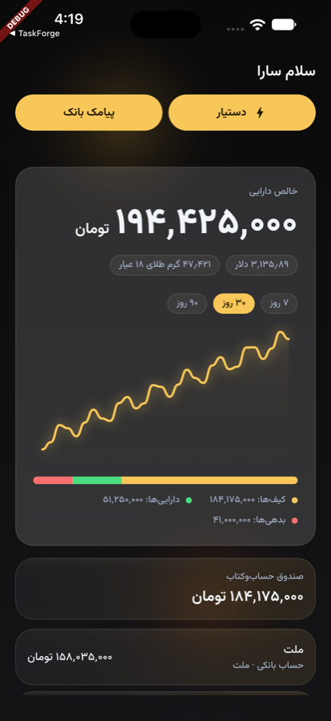
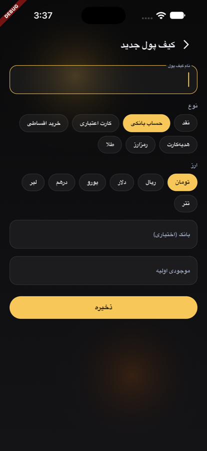

<div align="center">

# سوما · Summa

**حسابداری شخصی برای ایران: خرج، قسط و دارایی را یک‌جا ببین.**

*Personal accounting for Iran: expenses, installments and assets in one place. Persian-first, multi-currency, fed by bank SMS.*

Flutter · Django · gRPC · PostgreSQL · Redis · Celery

</div>

<p align="center">
  
  
  
  
</p>

### صفحه‌های بزرگ

از ۹۰۰ نقطه به بالا (دسکتاپ و تبلت بزرگ) خانه به داشبورد با نوار کناری و دو ستون کارت تبدیل می‌شود؛ پایین‌تر از آن یک ستون وسط‌چین است. تصویر اول: iPad Pro ‎13 اینچی (همان چیدمان دسکتاپ)، تصویر دوم: iPad mini.

<p align="center">
  
  
</p>

## چه کار می‌کند

- **کیف پول‌ها:** هر تعداد کیف پول با ارز و بانک دلخواه (نقد، حساب بانکی، کارت اعتباری، خرید اقساطی، هدیه‌کارت، رمزارز، طلا). موجودی از رویدادها ساخته می‌شود و موجودی اولیه هنگام ساخت پرسیده می‌شود.
- **دفتر:** ثبت خرج و درآمد، انتقال بین کیف پول‌ها با کارمزد اختیاری و نرخ تبدیلی که خودت می‌دهی، تقسیم یک خرج بین چند دسته، برگشت وجه.
- **دسته‌ها و سقف ماهانه** با هشدار، تراکنش‌های تکراری، یادآور حقوق و ساعت روزانهٔ حساب‌وکتاب.
- **وام و قسط:** جدول اقساط، «پرداخت شد» و یادآوری.
- **دارایی و قیمت:** طلا، ارز و دارایی دلخواه با نرخ تقریبی که بک‌اند هر چند ساعت تازه می‌کند.
- **خالص دارایی:** یک عدد بزرگ به تومان، معادل دلار و گرم طلا، نمودار ۷/۳۰/۹۰ روزه و سهم کیف‌ها، دارایی‌ها و بدهی‌ها. سبدهای هدف هم دارد.
- **پیامک بانک:** متن پیامک را share یا paste می‌کنی؛ بک‌اند با regex هر بانک و یک مدل کوچک Ollama آن را می‌خواند. مبلغ باید عیناً در متن باشد و متن خام به‌طور پیش‌فرض ذخیره نمی‌شود.
- **دستیار:** چت خصوصی داخل اپ. دستیار فقط بررسی و پیشنهاد می‌دهد؛ دکمهٔ «ثبت» همان درخواست معمولی ثبت را از گوشی خودت می‌فرستد و دستیار هیچ دسترسی نوشتن ندارد.
- **حریم و امنیت:** قفل اپ با بیومتریک یا رمز داخل اپ، و خروجی/ورود داده فقط بعد از تأیید هویت.
- **آفلاین و چنددستگاه:** صف تغییرات محلی و همگام‌سازی.

فقط ایران و فارسی (RTL، تقویم شمسی). چند ارز و چند نوع کیف پول نگه داشته شده‌اند.

## ساختار

```
app/       Flutter: اندروید، iOS، macOS (یک کدبیس)
backend/   Django + gRPC (REST هم برای سایت)، PostgreSQL، Redis، Celery
landing/   سایت معرفی تعاملی (Vite + Three.js) با دموی چت زنده و ماشین‌حساب‌ها
deploy/    docker compose برای Postgres و Redis
docs/      مستندات فارسی، نقشهٔ راه و سند هر فاز
```

## شروع سریع

پیش‌نیاز: Flutter، Python 3.14، و برای قراردادها `brew install protobuf buf` و `dart pub global activate protoc_plugin`.

```bash
make setup      # venv بک‌اند + وابستگی‌ها + flutter pub get
make run-lite   # بدون Docker: migrate + REST (:8010) + gRPC (:50051)
make macos      # اپ روی macOS (در ترمینال دیگر)
```

کد ورود پیامکی در محیط توسعه به ترمینال `make run-lite` چاپ می‌شود.

| فرمان | کار |
|---|---|
| `make run-lite` | بک‌اند سبک با SQLite و حافظه، بدون Docker |
| `make dev` / `make down` | بک‌اند کامل با Postgres و Redis |
| `make macos` | اجرای اپ روی macOS |
| `make proto` | ساخت دوبارهٔ stub های Python و Dart (پروتوی جدید را به `DART_PROTOS` اضافه کن) |
| `make check` | lint، type، migration، proto، format و analyze |
| `make test` | pytest و flutter test |
| `make landing` / `make landing-test` | سایت معرفی و آزمون‌هایش |

برای اجرا روی شبیه‌ساز iOS، اپ را با `--dart-define=GRPC_HOST=...` و `GRPC_PORT=...` بساز؛ پیش‌فرض‌ها `localhost:50051` (و `10.0.2.2` برای شبیه‌ساز اندروید) هستند.

## فناوری

| بخش | انتخاب |
|---|---|
| اپ | Flutter، Riverpod، gRPC، تم تیرهٔ شیشه‌ای با طلایی و انیمیشن (احترام به reduced-motion) |
| بک‌اند | Django و gRPC، PostgreSQL، Redis، Celery (نرخ‌ها هر چند ساعت) |
| پیامک | regex هر بانک + Ollama، با اعتبارسنجی schema |
| سایت | Vite و Three.js؛ محتوا و قیمت‌ها از API بک‌اند و قابل ویرایش در ادمین |

## مستندات

مستندات فارسی در [`docs/`](docs/README.md): تحقیق مرجع، [سؤال‌های باز](docs/05-open-questions.md)، [معماری](docs/06-architecture.md)، [نقشهٔ راه](docs/07-roadmap.md)، [مدل داده](docs/10-data-model.md)، [مدل امنیتی](docs/12-security-model.md). قواعد کار برای انسان و هوش مصنوعی در [AGENTS.md](AGENTS.md).

## مشارکت

یک فاز، یک ویژگی؛ اول سند فاز (`docs/08-phase-template.md`) و بعد کد. پیام‌های commit به سبک emoji Conventional Commits است ([راهنما](docs/GIT_COMMIT_CONVENTIONS.md)). قبل از ارسال، `make check` و `make test` باید سبز باشند.
