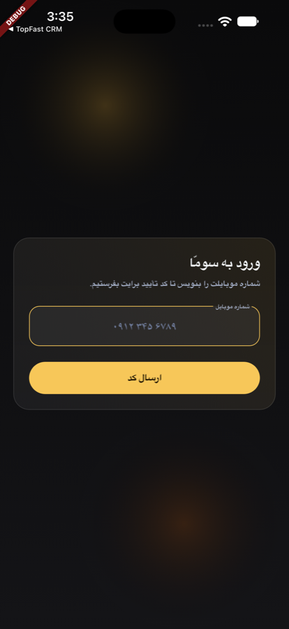
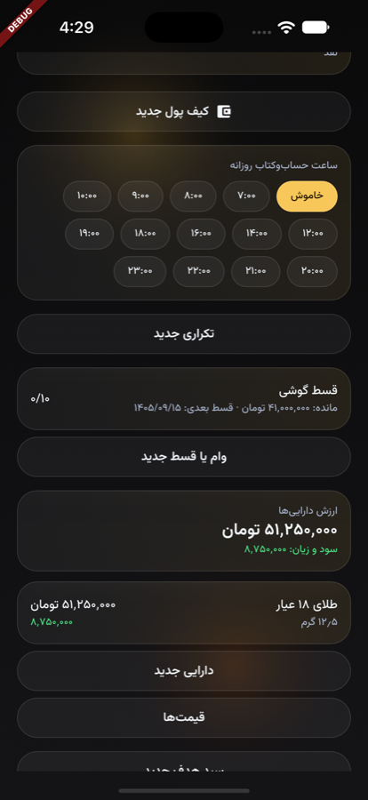
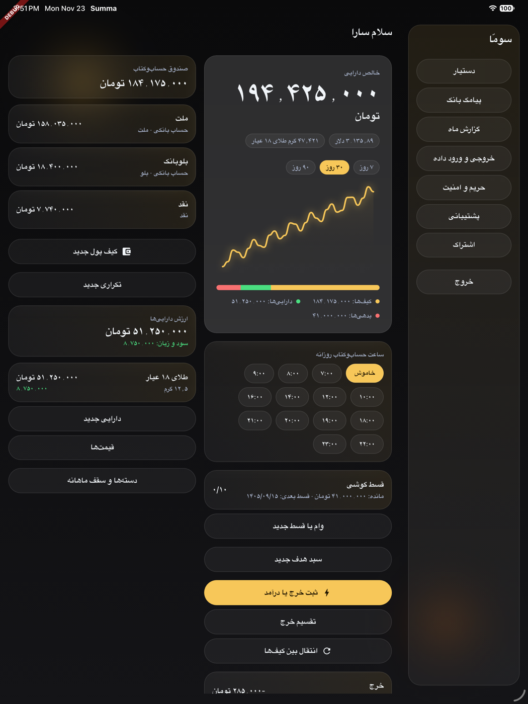
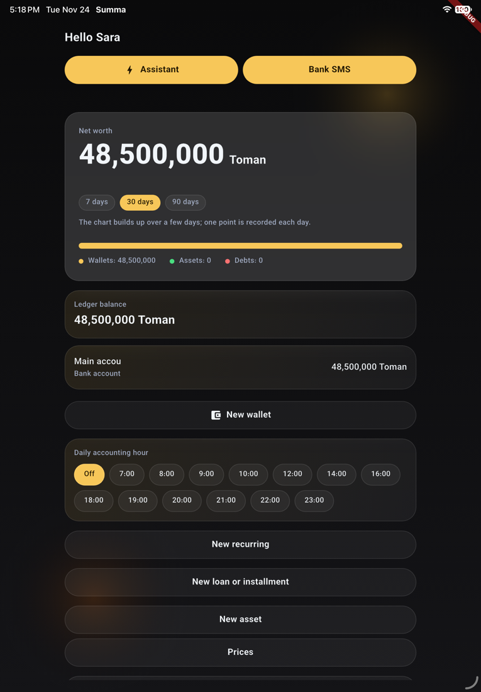
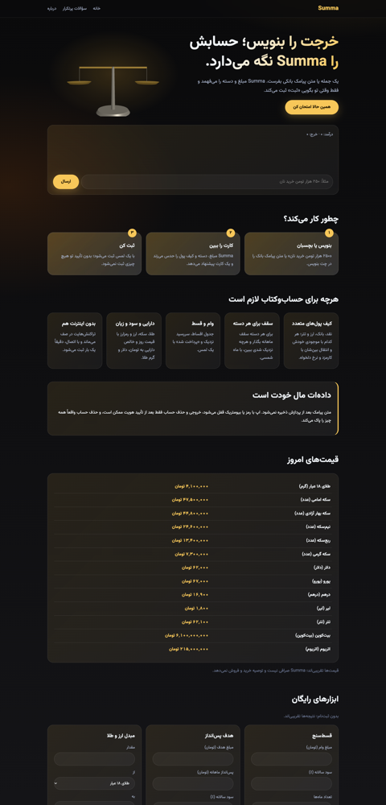
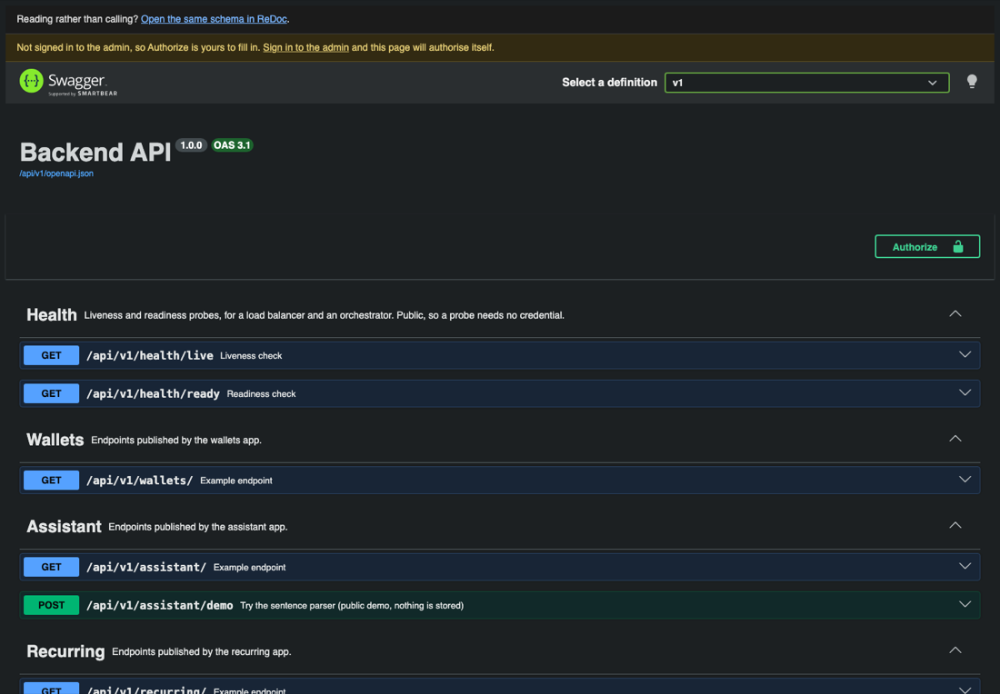

<div align="center">

# Summa

**Personal accounting for Iran: see expenses, installments and assets in one place.**

*Persian-first, multi-currency, fed by bank SMS.*

Flutter · Django · gRPC · PostgreSQL · Redis · Celery

**[Live preview of the landing site →](https://ctrlaltdevelop.github.io/summa/)**

</div>

<p align="center">
  
  
  
  
</p>

### Large screens

From 900 px up (desktop and large tablets) Home becomes a dashboard with a sidebar and two columns of cards; below that it is a single centred column. First image: iPad Pro 13" (same layout as desktop), second: a small tablet.

<p align="center">
  
  
</p>

### Landing site

The public site lives in `landing/` (Vite and Three.js) with a live chat demo, today's prices from the backend API, an installment calculator and free tools. Copy and prices are editable in the admin. `make landing` (alongside `make run-lite`) serves it on `http://localhost:5173`. A [static preview](https://ctrlaltdevelop.github.io/summa/) is also on GitHub Pages; it has no backend, so prices are samples and the chat demo does not work. The prices in the screenshot are samples too.

<p align="center">
  
</p>

### API docs

The backend ships Swagger: after `make run-lite`, open `http://127.0.0.1:8010/api/docs` (ReDoc at `/api/redoc`) and the admin panel at `/admin/`. In production the docs are off by default (`DJANGO_API_DOCS_ENABLED=true` turns them on). The app speaks gRPC; Swagger only shows REST.

<p align="center">
  
</p>

## What it does

- **Wallets:** any number of wallets with any currency and bank (cash, bank account, credit card, installment purchase, gift card, crypto, gold). Balances are built from events, and the initial balance is asked for at creation.
- **Ledger:** record expenses and income, transfer between wallets with an optional fee and a rate you enter yourself, split one expense across several categories, refunds.
- **Categories and monthly caps** with warnings, recurring transactions, salary reminders and a daily accounting hour.
- **Loans and installments:** an installment schedule, "mark as paid" and reminders.
- **Assets and prices:** gold, currencies and custom assets, valued at approximate rates the backend refreshes every few hours.
- **Net worth:** one big number in Toman, with its dollar and gold-gram equivalents, a 7/30/90-day chart and the share of wallets, assets and debts. Goal buckets are included.
- **Bank SMS:** share or paste the SMS text; the backend reads it with per-bank regexes and a small Ollama model. The amount must appear verbatim in the text, and the raw text is not stored by default.
- **Assistant:** a private chat inside the app. The assistant only analyses and suggests; its "Register" button sends the normal register request from your own phone, and the assistant has no write access.
- **Privacy and security:** app lock with biometrics or an in-app passcode, and data export/import only after identity confirmation.
- **Offline and multi-device:** a local change queue and sync.

Iran and Persian only for now (RTL, Shamsi calendar). Multiple currencies and wallet types are kept. English and non-Iran country profiles are planned as phases 19 and 19b.

## Layout

```
app/       Flutter: Android, iOS, macOS (one codebase)
backend/   Django + gRPC (plus REST for the site), PostgreSQL, Redis, Celery
landing/   interactive landing site (Vite + Three.js) with a live chat demo and calculators
deploy/    docker compose for Postgres and Redis
docs/      documentation, roadmap and one doc per phase
```

## Quick start

Prerequisites: Flutter, Python 3.14, and for the contracts `brew install protobuf buf` and `dart pub global activate protoc_plugin`.

```bash
make setup      # backend venv + dependencies + flutter pub get
make run-lite   # no Docker: migrate + REST (:8010) + gRPC (:50051)
make macos      # the app on macOS (in another terminal)
```

In development the SMS sign-in code is printed to the `make run-lite` terminal.

| Command | What it does |
|---|---|
| `make run-lite` | lightweight backend with SQLite and in-memory cache, no Docker |
| `make dev` / `make down` | full backend with Postgres and Redis |
| `make macos` | run the app on macOS |
| `make proto` | regenerate the Python and Dart stubs (add a new proto to `DART_PROTOS`) |
| `make check` | lint, types, migrations, proto, format and analyze |
| `make test` | pytest and flutter test |
| `make landing` / `make landing-test` | the landing site and its tests |

To run on the iOS simulator, build the app with `--dart-define=GRPC_HOST=...` and `GRPC_PORT=...`; the defaults are `localhost:50051` (and `10.0.2.2` for the Android emulator).

## Stack

| Part | Choice |
|---|---|
| App | Flutter, Riverpod, gRPC, dark glass theme with gold accents and animation (respects reduced motion) |
| Backend | Django and gRPC, PostgreSQL, Redis, Celery (rates every few hours) |
| SMS | per-bank regex + Ollama, schema-validated |
| Site | Vite and Three.js; content and prices come from the backend API and are editable in the admin |

## Documentation

Docs live in [`docs/`](docs/README.md): reference research, [open questions](docs/05-open-questions.md), [architecture](docs/06-architecture.md), [roadmap](docs/07-roadmap.md), [data model](docs/10-data-model.md), [security model](docs/12-security-model.md). Working rules for humans and AI are in [AGENTS.md](AGENTS.md).

## Contributing

One phase, one feature: the phase doc (`docs/08-phase-template.md`) comes first, then code. Commit messages follow emoji Conventional Commits ([guide](docs/GIT_COMMIT_CONVENTIONS.md)). Before sending a change, `make check` and `make test` must be green. The full guide is in [CONTRIBUTING.md](CONTRIBUTING.md). Report vulnerabilities privately, not in an issue: [SECURITY.md](SECURITY.md).

## License

[GNU AGPL-3.0](LICENSE). Anyone who runs a modified version as a service must publish the changes.
